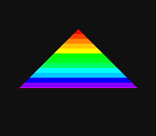
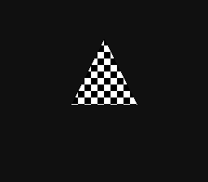

# DiscoC: A Systems Language and Cross-Compilation Toolchain

[](https://github.com/DiscoLabOfficial/DiscoC/actions/workflows/cmake.yml)

DiscoC is a freestanding systems programming language and a compiler, assembler,
and linker for specialized hardware. Its C-like syntax has explicit rules for
small integers, banked memory, hardware access, and target capabilities.
It is **not an ISO C implementation**.

The toolchain is written in C++23, with an experimental C++14 DOS cross-build.
SuperFX programs can be compiled into real SNES execution payloads without LLVM.

> **Experimental — [v0.2.0-rc.1 is available](https://github.com/DiscoLabOfficial/DiscoC/releases/tag/v0.2.0-rc.1).**
> The release candidate adds explicit `-O0`, `-O1`, `-O2`, and `-Os` policies.
> The language remains Baseline 0.1; syntax, ABI, and object format may change
> before 1.0. Generated code is not guaranteed to be optimal.
> A linked `.bin` is a fixed-origin GSU payload, **not a complete SNES ROM**.

The [release page](https://github.com/DiscoLabOfficial/DiscoC/releases/tag/v0.2.0-rc.1)
contains packaged tools and final validation evidence for the tagged revision.
[v0.1.0](https://github.com/DiscoLabOfficial/DiscoC/releases/tag/v0.1.0) remains
the first stable-channel baseline release.

## Supported Targets

| Target | Current support |
| --- | --- |
| `gsu` / `superfx` | Compilation, assembly, relocatable objects, linking, and ROM/RAM execution payloads. |
| `spc700` | Frontend analysis, capability diagnostics, and verified IR; no executable backend yet. |

Select the target through the CLI or `discoc.toml`. Hardware-specific operations
are capability-checked. The three tools are `discc` (compiler/project builder),
`discas` (assembler), and `discld` (linker).

## Building from Source

With a C++23 compiler, CMake 3.21+, and Ninja, run from the repository root
on Linux/macOS or a Windows MSVC Developer shell:

```sh
cmake --preset release
cmake --build --preset release
ctest --preset release
```

Windows MinGW-w64 users with `g++` and `mingw32-make` on `PATH` use:

```sh
cmake --preset release-mingw
cmake --build --preset release-mingw
ctest --preset release-mingw
```

Executables are in `build/<preset>/bin` (`.exe` on Windows). Add that directory
to your shell's `PATH`. See [Building DiscoC](docs/building.md) for prerequisites,
Debug presets, Make/build helpers, direct GCC/Clang builds, and DOS cross-builds.

## Quick Start: A Multi-File Project

With `discc` on `PATH`, build the included example from the repository root:

```sh
discc build --config examples/multifile/discoc.toml
```

Inside your own project, `discc build` reads the local `discoc.toml`.
`import "math.dc";` shares declarations, not pasted source; project builds
discover and compile implementation dependencies once.

Use `-O1` for local optimization, `-O2` for speed-oriented global optimization,
or `-Os` for size-oriented output; the default is `-O0`. CLI settings override
the manifest. Smaller code can be slower: measure your workload.

Follow the [two-file tutorial](docs/getting-started.md) to create a project,
export byte-exact final assembly, and understand the SNES host boundary.
See [project manifests](docs/project-manifest.md) for configuration and
[GSU loading](docs/gsu-loading.md) before executing a payload.

## PLOT: Stateful SuperFX Graphics

DiscoC exposes the GSU's plotting state directly:

```c
// Inside a function, with a bitmap selected and the host configured:
plot {
    color 5;
    at (10, 20); // cursor.x = 10; cursor.y = 20;
    for (word i = 0; i < 16; i++) {
        pixel; // PLOT draws and increments cursor.x in hardware.
    }
    flush; // RPIX flushes the pixel caches; discard the result.
}
```

`cursor.x/y` map to R1/R2. Eligible direct ROM byte colors can use GETC;
RAM and computed colors use COLOR. Bitmap declarations describe framebuffer
configuration; the SNES host still configures SCMR/SCBR and the display.
See the [complete graphics contract](docs/gsu-graphics.md).

### Filled Triangle

Calculated and drawn by SuperFX code generated from
[DiscoC source](examples/snes/triangle/main.dc), then displayed by a SNES host:



[Build the complete ROM and run independent Mesen checks](examples/snes/triangle/README.md).

### Rotating Checkerboard Triangle

Integer fixed-point rotation, cached pixel loops, and a checkerboard calculated
at runtime — no pre-rendered geometry frames:



The GIF replays captured poses at 8 fps; **its playback rate is not measured ROM
throughput**. [Build, verification, and timing instructions](tests/graphics/rotating_triangle/README.md)
cover all 64 poses and distinguish GSU cycles from completed-image FPS.

The [interactive OBJ demo](tests/graphics/interactive_shapes/README.md) adds a
cube and an icosahedral sphere: D-Pad rotation, A to toggle wireframe/filled faces,
and Select + Up/Down to resize, using OBJ/4bpp at approximately 21 MHz.

**The example SNES ROMs contain no Nintendo proprietary code, commercial game
assets, or Nintendo SDK components.** These are emulator demonstrations, not
physical-hardware validation.

## Documentation

- [Documentation index](docs/README.md) — guides, contracts, and release records.
- [Language specification](docs/language-spec.md) — the Baseline 0.1 source of truth.
- [Examples and libraries](docs/examples.md) — SNES demos, imports, and fixed-point helpers.
- [Optimization](docs/optimization.md) and [benchmarks](benchmarks/README.md) — policies, reproducible bytes/cycles, and measurement limits.
- [Testing](docs/testing.md) — conformance, execution models, sanitizers, and Mesen integration.
- [Architecture](docs/architecture.md) and [roadmap](ROADMAP.MD) — internals and future work.

## Contributors and Community

- [DiscoManOfficial](https://github.com/DiscoManOfficial) — project author and maintainer.
- [k0b3n4irb](https://github.com/k0b3n4irb) — hardware-loop and exhaustive switch-return correctness fixes and regression tests.
- [araesmojo-eng](https://github.com/araesmojo-eng) — independent SuperFX integration testing and origin/runtime feedback in [issue #9](https://github.com/DiscoLabOfficial/DiscoC/issues/9).

Thanks to everyone reporting bugs, testing programs, and improving the project.
See the [contributor history](https://github.com/DiscoLabOfficial/DiscoC/graphs/contributors),
[contribution guide](CONTRIBUTING.md), and [Code of Conduct](CODE_OF_CONDUCT.md).
The private conduct-reporting contact is currently pending.

## License

DiscoC is licensed under [GNU GPL v3 or later](LICENSE), without warranty.
The Code of Conduct has its own [CC BY-SA 4.0 attribution](CODE_OF_CONDUCT.md#attribution).
