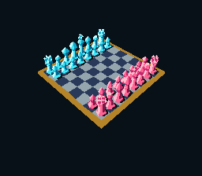

# Gem chess: a complete SuperFX scene



A full 8×8 board and 32 opaque, faceted gemstone pieces, calculated and drawn
by DiscoC on the GSU. There are six mesh silhouettes: pawn, crenellated rook,
leaning knight, pointed bishop, crowned queen and king with an extruded cross.
The cyan and ruby armies start in the usual chess arrangement. This is a
scene/camera demo, **not a chess engine**; there are no move rules or computer opponent.

The camera really orbits in 3D, with perspective, elevation and distance.
The image is not a pre-rendered background, a sprite rotation or a wireframe
passed off as a solid scene. Lighting is opaque, quantized directional flat
shading, not transparency, refraction or ray tracing.

## Build and play

Build DiscoC following [the normal build instructions](../../../docs/building.md).
Put `wla-65816` and `wlalink` on PATH, then run from the repository root:

```sh
cmake -DDISCO_TOOLS_DIR=build/release/bin -P examples/snes/gem_chess/build-snes.cmake
```

Open **`build/gem-chess-scene/gem-chess.sfc`** in a SuperFX-capable emulator.
This is a complete 64-KiB SNES ROM. Map the player-one SNES controller:

| Control | Action |
| --- | --- |
| Left / Right | Orbit the camera around the board |
| Up / Down | Raise / lower camera elevation |
| Select + Up / Down | Zoom in / out by changing camera distance |
| A press | Toggle shaded faces / visible-edge wireframe |
| Start | Restore the default camera and shaded mode |

Yaw wraps through 64 positions; elevation is clamped to phases 5..10 and zoom
to 6..16. Opposing directions cancel. A held down toggles once. The SNES CPU
continues polling input during rendering; each render receives a coherent
snapshot and unchanged input does not trigger unnecessary redraws.

The default is **O2, 256×192 bitmap, 4bpp, NTSC, CLSR=1 (~21.477 MHz), normal
multiply timing**. The PPU presents this full scene through BG1, not the two
small OBJ panels used by the separate interactive-shapes demo. There is no
emulator overclocking. `-DOPTIMIZATION=s` requests the size-oriented pipeline;
the checked linker must still accept its code/stack placement. Local Mesen
runtime verification covers the current O2 source as recorded below. Os passes
current compile/link/assembly-equivalence checks, but full-scene Os Mesen runtime
has not been run.

Tool paths and output directories can be explicit; quote paths with spaces:

```sh
cmake -DDISCO_TOOLS_DIR=/path/to/discoc/bin \
  -DWLA_65816=/path/to/wla-65816 -DWLALINK=/path/to/wlalink \
  -DOUTPUT_DIR=build/my-chess -P examples/snes/gem_chess/build-snes.cmake
```

For only the GSU payload and byte-exact assembly, without a SNES host:

```sh
discc build --config examples/snes/gem_chess/discoc.toml
```

## Renderer

All geometry uses bounded signed 16-bit integers and symmetric Q6 rounding.
The camera looks at `(0,10,0)`, uses focal length 256 and an integer reciprocal
table for perspective. The table is built once per render using an exact
quotient/product recurrence, shared by every vertex, without a division per
depth entry. Out-of-range depth is diagnosed through the host mailbox rather than
indexing an uninitialized table entry.

Pieces are separated vertical bodies, painted far-to-near using unsigned,
scaled **radial camera distance**, not just Z order. Convex height bands are
painted bottom-to-top. Integer ring rounding can make a four-corner band face
nonplanar: per-band diagonal masks select its convex hull and its triangles
are culled independently. Two visible triangles share a fill only when their
screen projection is convex. Planar faces use the same independent-triangle
culling because integer perspective can fold their projection at grazing angles.
Extra convexity determinants are computed only when both triangles are visible;
hidden triangles need no temporary coordinate copy. Vertex coordinate offsets
and edge differences are reused within each face.
Crowns and the king's cross use separate convex
parts. This is a renderer for this bounded scene, not a general intersecting-
mesh/Z-buffer engine.

World-space facet direction and slope select a five-tone material ramp.
In-viewport clockwise convex faces seed only their vertex rows. A per-side edge
collector writes interior boundary rows directly and groups horizontal runs,
preserving the midpoint recurrence and its tie rule. Clipped faces and
horizontal/point degeneracies retain the generic extrema collector and interval
initialization. Wireframe retains the checked midpoint line renderer. Cached horizontal
spans use `pixel;` and its hardware R1 increment; the final `flush;` commits
pending pixel-cache data before STOP. Every render explicitly resets POR and
clears the entire framebuffer, so camera changes cannot leave old pieces.

## Safe presentation and memory

| Cartridge RAM, bank `$70` | Use |
| --- | --- |
| `$0000..5FFF` | 24-KiB, column-major 4bpp framebuffer |
| `$6000` upward | Fixed-origin GSU code and runtime bootstrap |
| Above payload, below `$EFFE` | Checked descending stack and local renderer arrays |
| `$F000` | Returned primitive count |
| `$F002/4/6/8` | Yaw, elevation, zoom and wireframe input |
| `$F010/12/14/16` | Normalized input echoes |
| `$F018` | Depth-domain error flag, normally zero |

The host obtains SCBR/SCMR/origin from final linked metadata. It checks STOP,
R6, R0 versus the mailbox, input echoes and stack restoration before uploading.
The ROM declares 64 KiB cartridge RAM and never accesses bank `$71`.

VRAM contains two 24-KiB character buffers, at bytes `$0000` and `$6000`, plus
a shared row-major tilemap at `$E000`. The SNES CPU uploads the inactive buffer
in **six 4096-byte chunks, one per fresh VBlank**, checking the beam after each.
Only then does it switch BG1's character base. The previously completed view
remains visible throughout rendering and transfer; no partial frame is shown.
Tile zero remains clear and supplies the blank rows below the 192-line scene.

This prioritizes correctness, not real-time frame rate. A filled default view
took several seconds in the historical measurements below; input polling is
60 Hz, but newly rendered views are not. `gem-chess-timings.csv` reports measured
GSU opcode-to-STOP cycles/seconds separately from host publication clocks.
It excludes DMA/presentation from the GSU sample and is **not an FPS result**.

### Historical optimization snapshot (2026-10-18)

This earlier stack-traffic comparison uses the frozen compiler and renderer
hashes listed below, not the current source. It compares against the preceding
renderer, not the older original scene. These are dated uncommitted development
measurements, not current-source validation or release benchmarks:

| O2 configuration | Payload bytes | Default filled GSU cycles | Default wireframe GSU cycles |
| --- | ---: | ---: | ---: |
| Accepted baseline compiler and renderer | 26,919 | 78,377,218 | 56,312,742 |
| Snapshot compiler, same baseline renderer | 24,777 | 68,270,253 | 49,821,154 |
| Snapshot compiler and revised renderer | 26,567 | 65,452,153 | 47,059,290 |

Compiler-only changes reduce filled/wireframe cycles by 12.90%/11.53%.
The combined result saves 352 bytes (1.31%) and 16.49%/16.43% of cycles against
the accepted baseline. The revised renderer costs 1,790 bytes versus the final
compiler-only build, trading code size for faster projection and edge collection.
Its 487-byte collector hot body plus frequent side join fit the actual CACHE
window without added padding; the whole function is not claimed to fit.

Both historical variants match all ten baseline BMPs, all 24,576 framebuffer bytes
and primitive counts. All 18 measured publications improve against baseline;
controller, STOP/ABI, bank/CACHE, VRAM/PPU, VBlank DMA and negative-ROM checks
pass. Measurements use bank `$70` RAM execution, stock NTSC GSU at 100%,
21,477,270 Hz and normal multiply timing. GSU samples exclude host publication
and are neither FPS nor physical-hardware measurements.

Local ignored evidence is under
`build/stack-traffic-verification/final-compiler-only-O2-runtime-a/` and
`build/stack-traffic-verification/final-combined-B-O2-runtime-a/`;
`final-artifacts-a/` retains the final ROM package. SHA256 provenance:

- Snapshot `discc`: `0DBED34CCD922E5FD16D7D2C927771842844D9381B4D7562CE13C932DC8369C0`.
- Baseline renderer: `A006B14EFBA752B9BE24594D6EFC8973F2E20F7F4F786560D9CF9D903FCE1BCD`.
- Revised renderer: `CECC4BB448C28FA47C822620CEC10E71F29792AF830A5C26D7FDBC39927C0997`.
- Final compiler-only payload: `4C0012122201A08D46D9724D39467D5CD34DAF33B9BB0FEFF8DA47AD0769F45E`.
- Final combined payload: `BA3A3307AC363191DCFBC38D2B0F98B37B74BE72FDA8F4A8255B9D6F6076959A`.
- Final combined ROM: `21DB4A84BC4677E02C66867C1CEC4F89BE3578D271DB3D48113B19033623413B`.

The optional [`--require-no-spills`](../../../docs/optimization.md#requiring-spill-free-allocation)
constraint did **not** pass for that snapshot: `project` required
30 mapped IR values in four unique 16-bit spill slots. This is not a current
spill count. The diagnostic leaves
existing output unchanged. Reduced stack traffic is not a spill-free scene or
a stackless ABI guarantee.

#### Earlier renderer-rewrite snapshot

The following uncommitted working-tree measurements separate compiler changes
from the renderer rewrite, using frozen tools and retained baseline captures:

| O2 configuration | Payload bytes | Default filled GSU cycles | Default wireframe GSU cycles |
| --- | ---: | ---: | ---: |
| Original compiler and renderer | 28,308 | 104,811,963 | 75,207,386 |
| Updated compiler, original renderer | 24,535 | 88,041,623 | 62,230,015 |
| Updated compiler and renderer | 26,919 | 78,377,218 | 56,312,742 |

Compiler-only changes save 13.33% of payload bytes and 16.00%/17.26% of
filled/wireframe cycles. The combined build saves 4.91% of bytes and
25.22%/25.12% of cycles against the original. The renderer trades 2,384 bytes
against compiler-only output for another 10.98%/9.51% cycle reduction.
The final default poses take 3.649310085 s filled and 2.621969273 s wireframe
at 21,477,270 Hz. These are emulator GSU timings, not FPS, physical-hardware
measurements or final-release benchmarks.

The independent combined O2 run matches all ten baseline BMPs, complete 24-KiB
framebuffers and primitive counts. The negative-ROM check also passes. Local
ignored evidence is under
`build/gem-opt-verification/integration-20261018-a/combined-v6-O2-serial-observation/`:
`run-result.json`, `capture-comparison.json` and `gem-chess-timings.csv`.
Frozen tool hashes are recorded in
`build/gem-opt-backend/checkpoint-tools-20261017-v1/manifest.txt`.
SHA256 provenance for this snapshot:

- Renderer source: `A006B14EFBA752B9BE24594D6EFC8973F2E20F7F4F786560D9CF9D903FCE1BCD`.
- Combined O2 payload: `E814F1E1112112D40DEDCD379BF718D58BD59FA5492667DA46D1CF145046B055`.

In that earlier snapshot, Os produces 26,384 bytes and passes compile/link and compiler/final-assembly
roundtrips; Os runtime was not tested. Reproduce with the build command above,
adding `-DOPTIMIZATION=s` for Os and using separate output directories. The
ignored evidence is a local development record, not published release evidence.

## Verification

### Local validation snapshot (2026-10-20)

The current renderer SHA-256 is
`F7E71425B8ACEC372FB62BA646AE8B68018DA586BC39DD41A5557C87A14E7745`;
the tested Release compiler SHA-256 is
`1FB60984D6493FECE006530C22F0E23A1139598F45A9E13B24F03686E9C278DE`.
O2 and Os payloads are 27,675 and 27,260 bytes respectively. Project/direct
builds, compiler assembly and final exports reconstruct identical bytes within
each policy. These are local source-validation results, not release benchmarks
or a new performance comparison with the historical tables.
The Mesen executable SHA-256 is
`8EF403D6B9AF32075416193914D7993CE8480B347FE1F20A0CFD9815374933E7`,
using the deterministic stock NTSC/CLSR=1/normal-multiply profile below.

The current O2 ROM passed positive and deliberate-failure Mesen runs, matching
all ten accepted baseline BMPs, complete 24,576-byte framebuffers and primitive
counts. Controller, STOP/ABI, VRAM/PPU and VBlank transfer checks passed. The
confirming runs completed in 45.984 s and 2.564 s wall time with both CLI and
external timeouts of 120 s and unchanged frame limits. These are test-process
durations, not rendering throughput or GSU-cycle measurements.

Twelve strict-allocation output-protection checks passed. The first offending
function, `project`, reports three IR-value spill slots; this is **not** the
whole scene's total spill count. Full-scene Os Mesen runtime remains unrun.
Native raster coverage and complete local suite results are described in
[testing](../../../docs/testing.md#gem-chess-local-validation).

With Mesen available:

```sh
cmake -DDISCO_TOOLS_DIR=build/release/bin -DMESEN=/path/to/Mesen \
  -DVERIFY_MESEN=ON -P examples/snes/gem_chess/build-snes.cmake
```

The build compares manifest/direct, compiler-assembly and final-export payloads
byte for byte. The Mesen verifier injects actual controller input and checks
normal STOP/ABI, complete framebuffer-to-VRAM equality, both VRAM buffers,
all 1024 tilemap entries, palette, all displayed pixels and VBlank completion.
It visits ten camera/mode states, including a formerly folded queen facet,
a grazing planar wall, the maximum-area plinth pose, zoom/elevation limits,
wireframe and reset.
A separate deliberately wrong-result ROM must display a solid red screen.

The widened-integer Lua geometry fixtures also check all **4224** bounded
camera combinations, signed area limits, convex-hull diagonal masks and the
planar/nonplanar culling regressions. These complement the real emulator runs; the
tests do not implement a second complete renderer or claim physical-hardware
validation. Captures, timings and verification logs are saved beside the ROM.
Local verification uses MesenCE **2.2.1**, build
`20ba206cef5ba207c21203176d02cb9f43dda9fb`, at the stock NTSC 21 MHz profile.

**The ROM contains no proprietary Nintendo code, Nintendo SDK components,
commercial game code or proprietary game assets.** Geometry, host and scene
are original. The screenshot is captured from the executing ROM.
